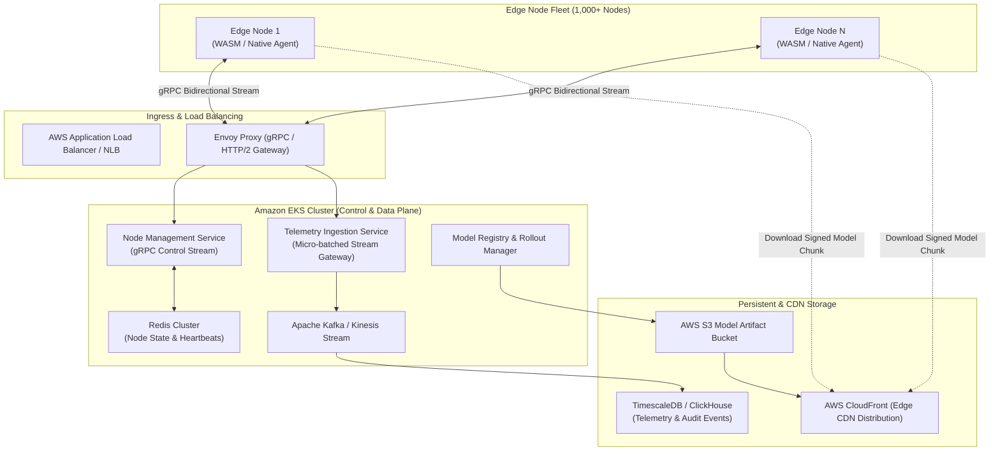

# GOLIATH PLATFORM ARCHITECTURE DESIGN DOCUMENT
## Milestone P0.3: Distributed Fleet Orchestration & Edge Control Plane

- **Author:** Staff Systems & MLOps Engineering
- **Target Scale:** 1,000+ Distributed Edge Nodes / 50k+ Events/sec
- **Status:** APPROVED / IN-PROGRESS

---

### 1. Architectural Scope & Target Topology
GOLIATH scales from a single-device prototype into a distributed Edge AI platform. The control plane manages node lifecycles, configuration synchronization, dynamic model artifact distribution, and high-throughput telemetry ingestion across 1,000+ edge workers.



---

### 2. Service Contracts (`gRPC / Protobuf v1`)

#### `proto/v1/fleet_control.proto`
```protobuf
syntax = "proto3";

package goliath.fleet.v1;

option go_package = "github.com/goliath/fleet/v1;fleetv1";

enum NodeStatus {
  NODE_STATUS_UNSPECIFIED = 0;
  NODE_STATUS_PROVISIONING = 1;
  NODE_STATUS_HEALTHY = 2;
  NODE_STATUS_DEGRADED = 3;
  NODE_STATUS_UPDATING = 4;
  NODE_STATUS_OFFLINE = 5;
}

enum ThreatLevel {
  THREAT_LEVEL_NONE = 0;
  THREAT_LEVEL_SUSPICIOUS = 1;
  THREAT_LEVEL_CRITICAL_INTRUSION = 2;
}

message HardwareProfile {
  string arch = 1;              // e.g. "x86_64", "arm64", "wasm32"
  string accelerator = 2;       // e.g. "webgl", "webgpu", "cuda_12_2", "cpu"
  uint32 total_ram_mb = 3;
  uint32 available_ram_mb = 4;
  float compute_score = 5;      // Normalized benchmark score
}

message NodeRegistrationRequest {
  string node_id = 1;
  string cluster_id = 2;
  string firmware_version = 3;
  string active_model_version = 4;
  HardwareProfile hardware = 5;
  map<string, string> tags = 6;
}

message NodeRegistrationResponse {
  bool registered = 1;
  string session_token = 2;
  uint32 heartbeat_interval_ms = 3;
  string assigned_model_version = 4;
  string model_manifest_url = 5;
}

message HeartbeatMessage {
  string node_id = 1;
  string session_token = 2;
  int64 timestamp_utc_epoch_ms = 3;
  NodeStatus status = 4;
  float inference_fps = 5;
  float inference_latency_ms = 6;
  float memory_usage_mb = 7;
  uint32 active_tracks_count = 8;
  uint32 total_detections_since_last = 9;
}

message CommandDirective {
  string directive_id = 1;
  enum Action {
    ACTION_NOOP = 0;
    ACTION_RESTART_INFERENCE = 1;
    ACTION_HOT_SWAP_MODEL = 2;
    ACTION_UPDATE_CONFIG = 3;
    ACTION_TRIGGER_DIAGNOSTICS = 4;
  }
  Action action = 2;
  string target_model_version = 3;
  string target_model_manifest_url = 4;
  string config_payload_json = 5;
}

message DetectionEvent {
  int64 timestamp_epoch_ms = 1;
  uint32 track_id = 2;
  string class_name = 3;
  float confidence = 4;
  repeated float bbox = 5;       // [x_min, y_min, x_max, y_max] normalized 0..1
  ThreatLevel threat_level = 6;
  bool in_restricted_zone = 7;
  bytes optional_snapshot_jpeg = 8;
}

message TelemetryBatch {
  string node_id = 1;
  string session_token = 2;
  int64 batch_sequence_id = 3;
  repeated DetectionEvent events = 4;
}

message TelemetryAck {
  int64 batch_sequence_id = 1;
  bool success = 2;
  string error_message = 3;
}

service FleetControlService {
  rpc RegisterNode(NodeRegistrationRequest) returns (NodeRegistrationResponse);
  rpc StreamControl(stream HeartbeatMessage) returns (stream CommandDirective);
  rpc StreamTelemetry(stream TelemetryBatch) returns (stream TelemetryAck);
}
```

---

### 3. Model Distribution & Verification Flow
1. **Registry Ingestion:** Training/quantization pipeline pushes ONNX/TensorRT artifacts to `s3://goliath-models/<model_id>/<version>/weights.onnx`.
2. **Signed Manifest Generation:** SHA-256 hash, input signature, tensor layouts, and target runtime requirements are packaged into `manifest.json`.
3. **CDN Invalidation & Warm-up:** CloudFront edge caches are primed for low-latency retrieval.
4. **Canary Rollout Engine:**
   - 5% Canary cohort selected based on hardware profile matching.
   - Directed via `CommandDirective.ACTION_HOT_SWAP_MODEL`.
   - Node streams drift telemetry for 15 minutes.
   - If drift threshold $\le 5\%$ degradation and FPS $\ge 95\%$ target, progression advances to 25% $\rightarrow$ 100%.

---

### 4. Edge Reliability & Failure Domains
- **Network Partition:** Edge node stores telemetry events in a bounded, priority-aware in-memory ring buffer (up to 10,000 events). Intrusion events (`THREAT_LEVEL_CRITICAL_INTRUSION`) are preserved with absolute priority over ambient non-intruder detections.
- **Node Drift / Memory Leak:** If inference latency exceeds SLA ($>150\text{ ms}$) or memory climbs above 80% quota, node transitions state to `DEGRADED`. Control plane issues automatic worker recycling without dropping camera ingest.
